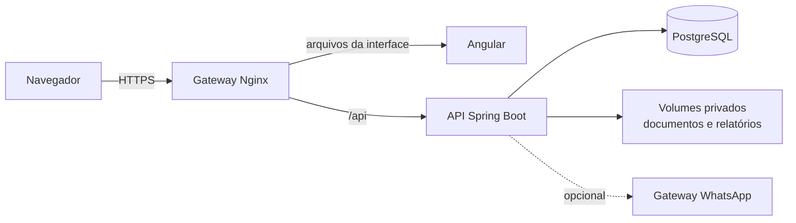

<div align="center">


# SAGER

**Sistema de Apoio à Gestão de Residentes**

Gestão das moradias estudantis do Instituto Federal Goiano, Campus Urutaí: cadastros, quartos, chamada noturna, saídas, comunicação, limpeza e relatórios em um só sistema.


[Sobre](#sobre) · [Funcionalidades](#funcionalidades) · [Arquitetura](#arquitetura) · [Como rodar](#como-rodar) · [Testes](#testes-e-qualidade) · [Documentação](#documentação) · [Licença](#licença)

</div>

---

## Sobre

Na residência estudantil do Campus Urutaí, a chamada noturna, o controle de saídas e retornos, o registro de ocorrências e a avaliação de limpeza dos quartos dependiam de papel. Isso gerava retrabalho, dificultava recuperar informações antigas e trazia risco de perder documentos.

O SAGER troca esses controles por registros digitais rastreáveis. É uma aplicação web responsiva, usada no computador e no celular, com acesso por perfil, auditoria de todas as alterações e medidas de proteção de dados pessoais compatíveis com a LGPD.

O sistema é o trabalho de conclusão do curso de Bacharelado em Sistemas de Informação do IF Goiano. Ele cobre os 27 requisitos funcionais (RF001 a RF027) da [monografia](#autores) e foi verificado por testes automatizados e numa instância de homologação técnica. Além do que a monografia descreve, tem login por usuário (o residente continua entrando com a matrícula), faixa etária do alojamento, encerramento da vaga de quem concluiu o curso e conversas com responsáveis pelo WhatsApp; cada acréscimo tem sua change no OpenSpec.

### Situação atual

O SAGER ainda não passou pela homologação das regras pela Assistência Estudantil e pela TI, nem por treinamento, teste piloto ou uso na rotina. Continuam pendentes o aviso de privacidade e a política de retenção dos dados, o servidor definitivo com cópias de segurança agendadas e medição de desempenho, e um novo teste de usabilidade sobre o sistema implementado. O conector de WhatsApp não foi testado com um número real. A lista completa está nas [pendências institucionais](docs/ARQUITETURA.md#pendências-institucionais).

## Funcionalidades

| Área | O que o sistema faz |
| --- | --- |
| **Acesso** | Login por usuário e senha (o residente usa a matrícula), sessão que expira após 30 minutos sem uso, recuperação de senha do residente pelos dados do cadastro e, em produção, bloqueio após cinco senhas erradas para a mesma conta em 15 minutos. |
| **Cadastros** | Residentes, responsáveis, cursos, supervisores, alojamentos, casas ou blocos e quartos. O cadastro do residente ou do supervisor já cria a conta de acesso. |
| **Quartos e alocação** | Mapa de quartos com vagas e situação, alocação e transferência com histórico, faixa etária do alojamento e encerramento automático da vaga de quem concluiu o curso. |
| **Chamada noturna** | Das 22h às 23h30, lista dos residentes menores alocados, congelada na abertura, marcação de presença, ausência justificada por saída válida e correção com justificativa. |
| **Saídas** | Pedido de saída curta (até 3 horas) ou longa pelo residente menor de idade, análise do supervisor, registro da partida e do retorno e expiração automática. Na saída longa, o supervisor confere a autorização do responsável antes de aprovar; a rejeição pode vir antes. |
| **Disciplina e avisos** | Notificações abertas pelo sistema para análise, advertências, termos de compromisso e avisos com versão e registro de ciência. |
| **Limpeza** | Avaliação de 0 a 10 em quatro critérios, histórico por quarto e ranking por semana, mês ou semestre. |
| **Relatórios e auditoria** | Catálogo de relatórios com exportação em PDF e planilha, e auditoria de criações, edições e decisões. |
| **WhatsApp (opcional)** | Envio do documento da saída longa ao responsável, recebimento da autorização e conversas com responsáveis por um gateway WAHA auto-hospedado e não oficial (não é a API da Meta), desligado por padrão. Ainda não foi testado com um número real; sem ele, o supervisor anexa o arquivo recebido por outro canal. |
| **Demonstração e ajuda** | Modo de demonstração com dados fictícios, sem conta, e página de ajuda por perfil. |

### Perfis

| Perfil | O que faz |
| --- | --- |
| **Gestor** | Mantém os cadastros, inclusive os supervisores, aloca residentes, acompanha limpeza e ranking, gera relatórios e consulta a auditoria pela API. |
| **Supervisor** | Mantém os cadastros, exceto supervisores, e cuida da rotina: chamada noturna, saídas e retornos, disciplina, avisos, limpeza e, quando o WhatsApp está ligado, conversas com responsáveis. Também gera relatórios e consulta a auditoria pela API. |
| **Residente** | Consulta o que é seu: comunicações, avaliações de limpeza e ranking. O residente menor de idade também pede saídas. |

Cada permissão é conferida no servidor, operação por operação e registro por registro. O passo a passo de cada perfil está no [guia de uso](docs/MANUAL.md).

## Arquitetura



A interface Angular roda no navegador e só mostra a cada perfil o que lhe cabe. Quem decide é a API Spring Boot: ela aplica as regras de negócio, confere a permissão, grava a auditoria na mesma transação e guarda tudo no PostgreSQL. Em produção, um gateway Nginx encerra o HTTPS, serve a interface e repassa `/api` ao backend, que fica numa rede privada.

| Camada | Tecnologias |
| --- | --- |
| Interface | Angular 22 (componentes standalone, Signals, Reactive Forms tipados), Angular Material, TypeScript 6 |
| API | Spring Boot 4.1, Java 21, Spring Security, Spring Session JDBC, JdbcTemplate, PDFBox, Apache POI |
| Dados | PostgreSQL 17, migrações Flyway (V1 a V33; a monografia descreve até a V21) |
| Infraestrutura | Docker Compose, Nginx, Coolify na homologação |
| Testes | Vitest, Playwright com axe-core, JUnit 6 com Testcontainers |

Detalhes em [docs/ARQUITETURA.md](docs/ARQUITETURA.md): módulos, contrato da API, segurança e as decisões tomadas, cada uma com a alternativa descartada.

### Estrutura do repositório

```text
SAGER/
├── backend/             API Spring Boot: um pacote por área, migrações Flyway e testes
├── frontend/            Interface Angular: telas por área, testes unitários e jornadas (e2e/)
├── infra/
│   ├── local/           Imagem da interface no ambiente local
│   ├── production/      Produção com Docker Compose, HTTPS, backup e restauração
│   └── coolify/         Homologação técnica no Coolify
├── openspec/
│   ├── specs/           Comportamento esperado de cada capacidade do sistema
│   └── changes/         Mudanças em andamento e histórico arquivado
├── docs/                Arquitetura, operação, guia de uso e desenvolvimento
├── compose.yaml         Ambiente local completo
├── compose.coolify.yml  Stack da homologação
├── sager                Comandos do dia a dia: up, down, logs, account, backup e ci
├── AGENTS.md            Regras de domínio e permissão e fluxo de trabalho
└── LICENSE              Licença de uso restrito
```

## Como rodar

Estas instruções servem aos autores, à equipe do IF Goiano e à banca. Qualquer outro uso depende de autorização por escrito; veja a [Licença](#licença).

**Pré-requisitos:** Docker com o plugin Compose e Bash (no Windows, o Git Bash). Node, Java e PostgreSQL rodam dentro dos containers.

1. Suba o sistema (a primeira compilação leva alguns minutos):

   ```bash
   ./sager up
   ```

2. Crie a primeira conta de gestor. O comando pede a senha duas vezes; não existe conta nem senha padrão.

   ```bash
   ./sager account create --matricula=TESTE-GESTOR --name='Gestor de Teste' --profile=gestor
   ```

3. Abra http://127.0.0.1:4200/acesso e entre com `TESTE-GESTOR` no campo **Usuário**.

`./sager down` para tudo sem apagar os dados. Os demais comandos e as contas estão em [docs/OPERACAO.md](docs/OPERACAO.md).

**Só quer conhecer as telas?** Rode só o passo 1, abra http://127.0.0.1:4200/acesso e use **Explorar com um perfil fictício**, sem conta. A demonstração usa dados fictícios em memória, não chama a API e não existe em produção.

**Para desenvolver a interface fora do Docker**, com o [backend rodando no host](backend/README.md) e Node.js 24:

```bash
cd frontend
npm ci
npm start
```

## Testes e qualidade

| Nível | Ferramenta | O que prova | Comando |
| --- | --- | --- | --- |
| Unidade e componente | Vitest | Regras, formulários, permissões de tela e navegação | `npm test -- --watch=false` em `frontend/` |
| Integração | JUnit 6 e Testcontainers | API, regras, permissões, CSRF, migrações e conflitos contra um PostgreSQL real e descartável | `./mvnw -B -ntp verify` em `backend/` |
| Jornada no navegador | Playwright e axe-core | Fluxos completos de cada perfil e acessibilidade, com a API simulada | `npm run test:e2e` em `frontend/` |
| Especificações | OpenSpec | Specs e mudanças bem formadas | `npx @fission-ai/openspec@2.0.0 validate --all --strict` na raiz |

Antes de mesclar e antes de cada deploy, rode na raiz:

```bash
./sager ci
```

Ele executa todas as verificações acima, mais os testes de infraestrutura, e grava um log por etapa em `.ci/`. Diferente do `./sager up`, roda na máquina e precisa também de JDK 21, Node.js 24 e Python 3; leva cerca de 30 minutos. Veja [docs/OPERACAO.md](docs/OPERACAO.md#verificação-local).

## Implantação

| Ambiente | Guia |
| --- | --- |
| Local | `./sager up`, descrito em [docs/OPERACAO.md](docs/OPERACAO.md) |
| Produção | [infra/production/README.md](infra/production/README.md): Docker Compose, gateway HTTPS, papéis separados no banco e backup criptografado |
| Homologação | [infra/coolify/README.md](infra/coolify/README.md): o mesmo stack no Coolify |

Em produção, as migrações rodam num processo separado, com um papel de banco próprio. A aplicação roda com um papel que não altera o schema nem a auditoria, e se recusa a iniciar com migração pendente ou configuração insegura.

**Servidor:** os serviços de produção têm limites que somam 1,6 GB de RAM e 1 CPU. Com o WhatsApp ligado, somam 2,4 GB e 1,6 CPU, e a VPS precisa de pelo menos 2 vCPU e 4 GB de RAM, mais swap. São limites de configuração, ainda sem medição de desempenho no servidor.

## Segurança e privacidade

- **Sem cadastro público.** O operador cria pelo terminal só as contas de gestor; as demais nascem com o cadastro do residente ou do supervisor.
- **Sessão no servidor.** Cookie `HttpOnly` e `SameSite=Lax`, proteção CSRF em toda escrita e expiração após 30 minutos sem uso.
- **Permissão no servidor.** A interface esconde o que não cabe ao perfil, mas a decisão é sempre da API. O residente só alcança os próprios dados.
- **Auditoria permanente.** Cada alteração grava autor, perfil, recurso e os nomes dos campos alterados, nunca os valores. O banco recusa apagar ou editar a auditoria.
- **Sem sobrescrita.** Toda edição envia a versão lida; se outra pessoa alterou antes, a gravação é recusada.
- **Dados sintéticos.** Desenvolvimento, testes e capturas de tela usam só dados fictícios.

A saída longa usa **autorização conferida**: o supervisor declara que conferiu responsável, documento e revisão, e só então pode aprovar; a rejeição, com motivo, pode vir antes. É uma revisão humana registrada, não uma assinatura eletrônica nos termos da Lei 14.063/2020.

## Como foi desenvolvido

1. **Requisitos** levantados com a Assistência Estudantil: 27 requisitos funcionais, 18 regras de negócio e 24 casos de uso.
2. **Modelagem** com UML (casos de uso, classes e sequência) e projeto do banco.
3. **Protótipo navegável** avaliado por sete participantes (três servidores da Assistência Estudantil e quatro residentes), com inspeção heurística, observação de tarefas e questionários. Os quatro residentes responderam ao System Usability Scale (SUS), um questionário de usabilidade de 0 a 100, com média de 83,1: um resultado indicativo, que não permite generalizar. Os problemas observados orientaram o redesenho das telas.
4. **Implementação e verificação:** interface Angular, API Spring Boot e banco PostgreSQL, verificados por testes automatizados e numa instância de homologação técnica. No começo, cada fase seguia um contrato em `docs/`; desde 31/10/2026, cada mudança de comportamento começa como uma change do [OpenSpec](https://github.com/Fission-AI/OpenSpec), com proposta, design e tarefas, e só é arquivada depois de testada.

O método, os padrões de código e o passo a passo para fazer uma mudança estão em [docs/DESENVOLVIMENTO.md](docs/DESENVOLVIMENTO.md).

## Documentação

| Documento | Para quem | Conteúdo |
| --- | --- | --- |
| [docs/MANUAL.md](docs/MANUAL.md) | Usuários | Como usar o sistema em cada perfil e o que fazer quando algo dá errado |
| [docs/ARQUITETURA.md](docs/ARQUITETURA.md) | Desenvolvedores | Camadas, módulos, contrato da API, segurança, decisões e pendências institucionais |
| [docs/DESENVOLVIMENTO.md](docs/DESENVOLVIMENTO.md) | Desenvolvedores | Método, padrões de código, testes e como fazer uma mudança |
| [docs/OPERACAO.md](docs/OPERACAO.md) | Operação | Ambiente local, contas pelo terminal e verificação local |
| [docs/whatsapp/OPERACAO.md](docs/whatsapp/OPERACAO.md) | Operação | Como ligar e operar o gateway de WhatsApp, e seus riscos |
| [backend/README.md](backend/README.md) | Desenvolvedores | Backend no host, perfis e comandos de conta |
| [frontend/README.md](frontend/README.md) | Desenvolvedores | Interface: instalação, comandos e pastas |
| [infra/production/README.md](infra/production/README.md) | Operação | Produção, HTTPS, backup e restauração |
| [infra/coolify/README.md](infra/coolify/README.md) | Operação | Homologação no Coolify |
| [openspec/specs](openspec/specs/) | Todos | Comportamento esperado de cada capacidade |
| [AGENTS.md](AGENTS.md) | Desenvolvedores | Regras de domínio e permissão em vigor |
| [PRODUCT.md](PRODUCT.md) e [DESIGN.md](DESIGN.md) | Design | Público, princípios e direção visual |

## Licença

Software proprietário, com **todos os direitos reservados**. O Instituto Federal Goiano tem licença gratuita para instalar, usar, manter e adaptar o sistema na Assistência Estudantil, sem poder cedê-lo a terceiros. A orientação e a banca podem executá-lo para avaliar o trabalho e, enquanto o repositório for público, os usuários do GitHub podem vê-lo e fazer fork na plataforma, como exigem os Termos de Serviço do GitHub. Qualquer outro uso, cópia, modificação ou distribuição depende de autorização por escrito dos autores; peça por uma issue neste repositório.

A titularidade ainda será confirmada com o IF Goiano ([pendências](docs/ARQUITETURA.md#operação-e-regras-de-uso)). O texto completo está em [LICENSE](LICENSE). Bibliotecas e fontes de terceiros seguem as próprias licenças, e a marca do IF Goiano pertence à instituição.

## Autores

| | |
| --- | --- |
| **Autores** | Guilherme Pereira da Silva e Otávio de Queiroz Franco |
| **Orientadora** | Cristiane de Fátima dos Santos Cardoso |
| **Instituição** | Instituto Federal Goiano, Campus Urutaí, Núcleo de Informática |
| **Curso** | Bacharelado em Sistemas de Informação |
| **Monografia** | *Modernização e automação na Assistência Estudantil do Instituto Federal Goiano - Campus Urutaí: desenvolvimento do Sistema de Apoio à Gestão de Residentes (SAGER)*, Urutaí, 2026 |
