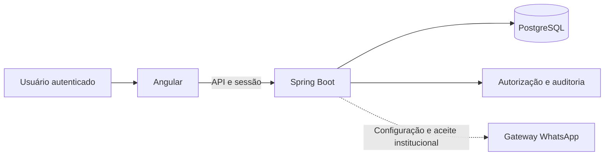

# SAGER

**Gestão da residência estudantil: cadastros, ocupação, chamadas, saídas e acompanhamento em um único sistema.**

Sistema de apoio à gestão da residência estudantil do **IF Goiano — Campus Urutaí**. Reúne uma interface Angular e uma API Spring Boot com persistência em PostgreSQL e autorização aplicada pelo servidor.

[Funcionalidades](#funcionalidades) · [Perfis](#perfis-e-acesso) · [Arquitetura](#arquitetura) · [Executar](#como-executar) · [Operação](#operação-e-homologação) · [Documentação](#documentação)

## Funcionalidades

| Domínio | Escopo implementado e documentado |
| --- | --- |
| Gestão | Residentes, responsáveis, supervisores, alojamentos, unidades, quartos e alocações. |
| Ocupação | Entrada, transferência e encerramento de alocação, preservando o histórico. |
| Chamada | Abertura, marcação, fechamento e correção motivada. |
| Saídas | Solicitação, decisão e registro de movimentos físicos conforme o tipo de saída e o perfil. |
| Comunicações | Áreas de comunicação e avisos integradas aos fluxos do sistema. |
| Saúde | Acesso separado por habilitação e vínculo assistencial; acesso próprio do residente quando autorizado. |
| Limpeza | Registros, correções, acompanhamento próprio e indicadores. |
| Relatórios | Consultas e visões individuais conforme as permissões de cada recurso. |

O detalhamento de cada entrega, seus contratos e limites está no [roteiro de implementação](docs/ROADMAP_IMPLEMENTACAO.md).

## Perfis e acesso

| Perfil | Papel no sistema |
| --- | --- |
| Gestor | Gestão, inclusive de supervisores, e consultas permitidas pelo contrato de cada módulo. |
| Supervisor | Gestão, exceto de supervisores, e operações de residência, incluindo atividades específicas como chamada. |
| Residente | Solicitações e consultas próprias associadas ao vínculo da conta. |
| Saúde | Entrada na conta; acesso ao conteúdo exige também habilitação profissional e vínculo assistencial. |

O cadastro de residente ou de supervisor cria a conta vinculada na mesma transação, com a matrícula ou SIAPE e a senha informadas no cadastro. O operador provisiona as demais contas e seus vínculos. Não há cadastro público de contas. A recuperação do residente confere nome, nascimento e nome de um responsável ativo quando houver; a recuperação dos demais perfis é administrativa.

Ter um perfil de gestão não concede acesso automático ao conteúdo de saúde. As permissões efetivas são verificadas pela API; os controles de navegação do Angular não substituem essa verificação.

## Arquitetura



Stack documentada: **Angular 22, Spring Boot 4.1, Java 21 e PostgreSQL 17**. O frontend se organiza por domínios, incluindo gestão, operações, comunicações, saúde, limpeza, relatórios e portal.

| Caminho | Conteúdo |
| --- | --- |
| [`frontend/`](frontend/) | Interface Angular, navegação, estados e testes de navegador. |
| [`backend/`](backend/) | API, regras, sessões, persistência, migrações e provisionamento de contas. |
| [`infra/production/`](infra/production/) | Operação com Compose, HTTPS e segredos externos. |
| [`docs/`](docs/) | Contratos por fase, manual, homologação e evidências. |

Para acompanhar o acesso às telas, consulte [`app.routes.ts`](frontend/src/app/app.routes.ts). O backend utiliza contas próprias de matrícula e senha, com sessão persistida no banco.

## Como executar

```bash
git clone https://github.com/dlr-1337/SAGER.git
cd SAGER
```

### Iniciar tudo com Docker

Instale somente Docker com Compose. Na raiz:

```bash
./sager up
./sager account create --matricula=TESTE-GESTOR --name='Gestor de Teste' --profile=gestor
```

O segundo comando solicita a senha duas vezes no terminal. Abra **http://127.0.0.1:4200/acesso** e entre com a matrícula escolhida. Não existe senha padrão. O cadastro assistido de residente cria sua conta vinculada, com a senha que ele escolher.

```bash
./sager status
./sager logs
./sager down
```

`up` reconstrói os serviços; `down` preserva banco, documentos e relatórios. A configuração privada fica em `.env.local` (permissão 600, excluída do Git). Não apague esse arquivo nem os volumes para redefinir uma conta. Consulte o [guia Docker e migração](docs/DOCKER.md), inclusive para reaproveitar um banco existente.

A demonstração pública continua disponível em desenvolvimento, com exemplos em memória. Uma falha da API apresenta um erro; a aplicação não troca para dados demonstrativos.

Para desenvolvimento sem Docker, os comandos de Angular e Maven continuam documentados no [backend](backend/README.md) e em [guia de CI](docs/CI.md).

## Verificação

Na pasta `frontend`:

```bash
npm run build
npm test -- --watch=false
npm run test:e2e
```

No backend, o fluxo `verify` do Maven Wrapper utiliza Testcontainers e PostgreSQL descartável. Os requisitos e comandos específicos de cada ambiente estão em [backend/README.md](backend/README.md).

O [guia de CI](docs/CI.md) explica a validação automatizada. Os resultados por revisão estão nos relatórios de QA, separados do aceite institucional.

## Operação e homologação

A produção exige configuração própria, HTTPS, segredos externos, contas provisionadas e preparação de migrações e recuperação. O seletor de demonstração fica desabilitado nesse ambiente.

**O WhatsApp usa um gateway auto-hospedado e não oficial, desligado por padrão, que depende de número dedicado, configuração e aceite institucional ([operação](docs/whatsapp/OPERACAO.md)). Não há provedor externo de assinatura. Google e SUAP foram adiados.** Esses itens não devem ser anunciados como integrações operacionais apenas porque existem telas ou contratos planejados.

As regras implementadas e os testes técnicos não substituem o aceite institucional nem a medição de capacidade na VPS definitiva. Registros de desenvolvimento, capturas e ensaios devem usar dados sintéticos, especialmente nos módulos de residentes e saúde.

## Documentação

| Documento | Finalidade |
| --- | --- |
| [Frontend](frontend/README.md) | Dependências, modo demonstrativo e comandos da interface. |
| [Backend](backend/README.md) | Banco, contas próprias, API e autorização. |
| [Produção](infra/production/README.md) | Compose, HTTPS, migrações, backup e recuperação criptografada. |
| [Manual por perfil](docs/fase-7/MANUAL.md) | Tarefas e uso do sistema. |
| [Homologação](docs/fase-7/HOMOLOGACAO.md) | Roteiro de avaliação. |
| [QA final](docs/fase-7/QA.md) | Evidências e limites da revisão. |
| [QA de matrícula e Docker](docs/QA-2026-10-16.md) | Verificação desta revisão, incluindo persistência e recuperação. |
| [PRD](SAGER_PRD_v2.0_Angular_SpringBoot.md) | Contexto e requisitos do produto. |
| [Especificação técnica](SAGER_Especificacao_Tecnica_v2.0.md) | Organização técnica e contratos. |
| [Direção visual](DESIGN.md) | Referência de interface. |
