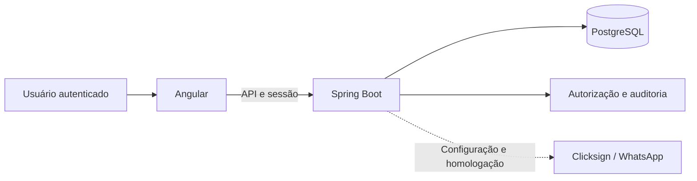

# SAGER

**Gestão da residência estudantil: cadastros, ocupação, chamadas, saídas e acompanhamento em um único sistema.**

Sistema de apoio à gestão da residência estudantil do **IF Goiano — Campus Urutaí**. Reúne uma interface Angular e uma API Spring Boot com persistência em PostgreSQL e autorização aplicada pelo servidor.

[Funcionalidades](#funcionalidades) · [Perfis](#perfis-e-acesso) · [Arquitetura](#arquitetura) · [Executar](#como-executar) · [Operação](#operação-e-homologação) · [Documentação](#documentação)

## Funcionalidades

| Domínio | Escopo implementado e documentado |
| --- | --- |
| Gestão | Residentes, responsáveis, supervisores, alojamentos, unidades, quartos e alocações. |
| Ocupação | Entrada, transferência e encerramento de alocação, preservando o histórico. |
| Chamada | Abertura, marcação, fechamento e correção motivada. |
| Saídas | Solicitação, decisão e registro de movimentos físicos conforme o tipo de saída e o perfil. |
| Comunicações | Áreas de comunicação e avisos integradas aos fluxos do sistema. |
| Saúde | Acesso separado por habilitação e vínculo assistencial; acesso próprio do residente quando autorizado. |
| Limpeza | Registros, correções, acompanhamento próprio e indicadores. |
| Relatórios | Consultas e visões individuais conforme as permissões de cada recurso. |

O detalhamento de cada entrega, seus contratos e limites está no [roteiro de implementação](docs/ROADMAP_IMPLEMENTACAO.md).

## Perfis e acesso

| Perfil | Papel no sistema |
| --- | --- |
| Gestor | Gestão e consultas permitidas pelo contrato de cada módulo. |
| Supervisor | Gestão e operações de residência, incluindo atividades específicas como chamada. |
| Residente | Solicitações e consultas próprias associadas ao vínculo da conta. |
| Saúde | Entrada na conta; acesso ao conteúdo exige também habilitação profissional e vínculo assistencial. |

**Cadastro de pessoa e conta de acesso são coisas diferentes.** Cadastrar um residente não cria automaticamente login. O operador provisiona as contas e vincula explicitamente cada identidade aos registros apropriados. Não há cadastro público de contas.

Ter um perfil de gestão não concede acesso automático ao conteúdo de saúde. As permissões efetivas são verificadas pela API; os controles de navegação do Angular não substituem essa verificação.

## Arquitetura



Stack documentada: **Angular 22, Spring Boot 4.1, Java 21 e PostgreSQL 17**. O frontend se organiza por domínios, incluindo gestão, operações, comunicações, saúde, limpeza, relatórios, assinatura e portal.

| Caminho | Conteúdo |
| --- | --- |
| [`frontend/`](frontend/) | Interface Angular, navegação, estados e testes de navegador. |
| [`backend/`](backend/) | API, regras, sessões, persistência, migrações e provisionamento de contas. |
| [`infra/production/`](infra/production/) | Operação com Compose, HTTPS e segredos externos. |
| [`docs/`](docs/) | Contratos por fase, manual, homologação e evidências. |

Para acompanhar o acesso às telas, consulte [`app.routes.ts`](frontend/src/app/app.routes.ts). O backend utiliza contas próprias de e-mail e senha, com sessão persistida no banco.

## Como executar

```bash
git clone https://github.com/dlr-1337/SAGER.git
cd SAGER
```

### Explorar a interface

O ambiente documentado utiliza **Node.js 24.19.0 e npm 11.17.0**:

```bash
cd frontend
npm ci
npm start
```

Abra **http://localhost:4200/acesso**. No desenvolvimento, **Explorar demonstração** permite navegar por perfis com dados sintéticos em memória. O exemplo de assinatura longa em `/assinatura/S-1048` é simulado.

### Usar dados persistidos

Prepare o banco, o backend e uma conta sintética conforme o [guia do backend](backend/README.md). São necessários JDK 21, Docker e configuração privada de `SAGER_DB_PASSWORD`. O guia inclui o Maven Wrapper, PostgreSQL local e os comandos de provisionamento.

O frontend utiliza proxy de `/api` para `127.0.0.1:8080`. O perfil local do backend fica restrito a loopback. **Uma falha da API não deve ser interpretada como autorização para usar dados demonstrativos:** os modos são distintos.

Não remova volumes de banco para trocar contas. O procedimento de provisionamento preserva o histórico e inclui criação, redefinição, desativação e vínculo explícito.

## Verificação

Na pasta `frontend`:

```bash
npm run build
npm test -- --watch=false
npm run test:e2e
```

No backend, o fluxo `verify` do Maven Wrapper utiliza Testcontainers e PostgreSQL descartável. Os requisitos e comandos específicos de cada ambiente estão em [backend/README.md](backend/README.md).

O [guia de CI](docs/CI.md) explica a validação automatizada. Os resultados por revisão estão nos relatórios de QA, separados do aceite institucional.

## Operação e homologação

A produção exige configuração própria, HTTPS, segredos externos, contas provisionadas e preparação de migrações e recuperação. O seletor de demonstração fica desabilitado nesse ambiente.

**Clicksign e WhatsApp dependem de credenciais, configuração e homologação externa. Google e SUAP foram adiados.** Esses itens não devem ser anunciados como integrações operacionais apenas porque existem telas ou contratos planejados.

As regras implementadas e os testes técnicos não substituem o aceite institucional nem a medição de capacidade na VPS definitiva. Registros de desenvolvimento, capturas e ensaios devem usar dados sintéticos, especialmente nos módulos de residentes e saúde.

## Documentação

| Documento | Finalidade |
| --- | --- |
| [Frontend](frontend/README.md) | Dependências, modo demonstrativo e comandos da interface. |
| [Backend](backend/README.md) | Banco, contas próprias, API e autorização. |
| [Produção](infra/production/README.md) | Compose, HTTPS, migrações, backup e recuperação criptografada. |
| [Manual por perfil](docs/fase-7/MANUAL.md) | Tarefas e uso do sistema. |
| [Homologação](docs/fase-7/HOMOLOGACAO.md) | Roteiro de avaliação. |
| [QA final](docs/fase-7/QA.md) | Evidências e limites da revisão. |
| [PRD](SAGER_PRD_v2.0_Angular_SpringBoot.md) | Contexto e requisitos do produto. |
| [Especificação técnica](SAGER_Especificacao_Tecnica_v2.0.md) | Organização técnica e contratos. |
| [Direção visual](DESIGN.md) | Referência de interface. |
