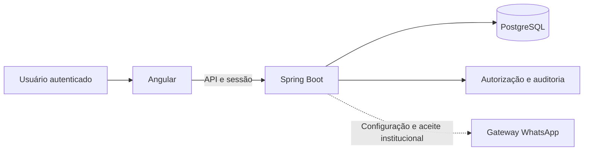

# Arquitetura do SAGER

Este documento descreve como o sistema está montado, por que foi montado assim e o que ainda depende de decisão institucional. As regras de comportamento ficam em [`openspec/specs`](../openspec/specs/), e as regras de permissão e domínio em vigor ficam no [AGENTS.md](../AGENTS.md). A operação dos ambientes está em [OPERACAO.md](OPERACAO.md).

## Visão geral e camadas

| Camada | Tecnologia | Papel |
| --- | --- | --- |
| Interface | Angular 22, componentes standalone, Signals e Reactive Forms tipados | Telas por perfil, validação de formulário e navegação. Esconde o que não cabe ao perfil, mas não decide permissão. Os serviços `*-api.service` chamam a API com `fetch`, o cookie de sessão e o token CSRF; os serviços `*-demo` guardam dados em memória e só servem à demonstração. |
| Entrada HTTPS | Nginx (produção) | Encerra TLS, serve a interface compilada, repassa `/api` ao backend e limita rajadas. |
| API | Spring Boot 4.1, Java 21, JdbcTemplate | Regras de negócio, autorização por operação e por registro, sessão, CSRF e auditoria. |
| Dados | PostgreSQL 17 com Flyway | Cadastros, operações, sessões, auditoria e contadores de login. |
| Arquivos | Volumes privados | Documentos permanentes (PDFs e anexos) e arquivos temporários de relatório. |
| WhatsApp | Gateway WAHA auto-hospedado, opcional | Envia o PDF da saída longa e recebe a autorização devolvida. Fica desligado por padrão. |

## Módulos por feature

### Frontend (`frontend/src/app`)

| Pasta | Conteúdo |
| --- | --- |
| `core` | Sessão autenticada e de demonstração, perfil ativo, mensagens de erro, estado de filtros e utilitários de listagem. |
| `shared` | Componentes e regras reutilizados: cabeçalho de página, paginação, campo e regras de senha, regras de campo. |
| `features/management` | Residentes, responsáveis, supervisores, cursos, alojamentos, unidades, quartos e alocações. |
| `features/operations` | Chamada noturna, saídas curtas e longas, conferência da autorização do responsável e notificações. |
| `features/communications` | Advertências, termos, avisos, comunicações do residente e conversas do WhatsApp. |
| `features/cleaning` | Avaliações de limpeza, indicadores e ranking. |
| `features/reports` | Catálogo de relatórios, consulta e exportação em PDF e Excel. |
| `features/portal` | Acesso, recuperação de senha, página inicial, perfil, ajuda e entrada na demonstração. |

As rotas ficam em `frontend/src/app/app.routes.ts`. Os testes unitários ficam ao lado do código (`*.spec.ts`) e as jornadas de navegador em `frontend/e2e/`.

### Backend (`br.edu.ifgoiano.sager`)

| Pacote | Conteúdo |
| --- | --- |
| `api` | Erros comuns, filtros de lista, relógio das operações e OpenAPI. |
| `audit` | Correlação por requisição, gravação e consulta da auditoria. |
| `auth` | Contas, login por usuário, sessão, CSRF, limite de tentativas, recuperação e comandos de conta. |
| `cleaning` | Avaliações de limpeza, correções, indicadores e ranking. |
| `communications` | Avisos versionados, leitura e ciência. |
| `conversations` | Conversas do supervisor com responsáveis pelo WhatsApp. |
| `discipline` | Ocorrências, notificações, advertências e termos de compromisso. |
| `documents` | Geração de PDF e armazenamento de arquivos privados. |
| `integrations` | Adaptador do gateway WhatsApp, webhook e tarefas de envio. |
| `management` | Cadastros: alojamentos, alocações, cursos, responsáveis, residentes, quartos e supervisores. |
| `operations` | Chamada noturna, saídas curtas e saídas longas. |
| `reports` | Catálogo, consultas congeladas e exportação assíncrona. |

As migrações ficam em `backend/src/main/resources/db/migration/` e os testes em `backend/src/test/java/`.

## Contrato da API

- Todas as rotas ficam sob `/api/v1` e trocam JSON. Datas civis usam ISO `YYYY-MM-DD`; instantes são gravados em UTC; identificadores são UUID.
- Cada resposta traz `X-Request-Id`, um UUID gerado pelo servidor. Um valor enviado pelo cliente não o substitui. O mesmo ID aparece no erro e nos logs.
- Erros têm o formato `{ code, message, requestId }`, inclusive JSON inválido, tipo errado, método ou formato não aceito, autorização e CSRF. A exceção é o `429` da recuperação de senha (`POST /api/v1/auth/recover`), que vem sem corpo, só com `Retry-After`. Exemplos: `401 unauthorized`, `401 invalid_credentials`, `403 forbidden`, `403 csrf_invalid`, `404 not_found`, `429 rate_limited` (login em produção). Falha inesperada devolve mensagem genérica, sem SQL, pilha ou valores enviados.
- Escrita sobre registro existente exige a versão lida (inteiro a partir de 0). Se outra conta alterou antes, a escrita é recusada e nada é sobrescrito.
- Listas de cadastro (alojamentos, responsáveis, residentes, quartos e supervisores) e de saídas aceitam `search`, `limit` (1 a 100) e `offset`, devolvem o corpo como array e informam o total em `X-Total-Count`. Avisos, comunicações do residente, ocorrências, notificações, advertências, termos, avaliações de limpeza e auditoria usam o cursor `beforeSequence`; as conversas do WhatsApp usam o cursor `before`. Cursos, alocações, chamadas noturnas e consultas de relatório voltam inteiras. A autorização é aplicada antes do filtro, da contagem e da paginação.
- O contrato OpenAPI fica em `GET /api/v1/openapi` só no perfil `local`, para gestor e supervisor autenticados. Em produção ele fica desligado.
- Logs saem em JSON, com o ID da requisição, sem corpo de requisição, credenciais ou valores pessoais.

## Segurança

- **Contas e login.** Login por usuário e senha; o usuário do residente é a matrícula, e o de gestor e supervisor é o identificador definido no cadastro ou pelo operador (o parâmetro da API continua `matricula`). Não há cadastro público: o operador cria pelo terminal só as contas de gestor, e o cadastro de residente ou de supervisor cria a conta vinculada na mesma transação. A senha tem pelo menos 8 caracteres e até 72 bytes; sequências, repetições, senhas comuns e o próprio usuário são recusados. A recuperação do residente confere nome, nascimento e nome de um responsável ativo, quando houver. A dos servidores é administrativa.
- **Sessão.** A sessão fica no PostgreSQL (Spring Session JDBC) e expira após 30 minutos sem uso. O cookie é `HttpOnly` e `SameSite=Lax`, e `Secure` em produção. Trocar senha, desativar a conta ou mudar o vínculo encerra as sessões. A cada requisição o servidor confere se a conta continua ativa e se perfil e vínculo ainda batem.
- **CSRF.** Toda escrita feita pela interface exige o token obtido em `GET /api/v1/auth/csrf`, enviado no cabeçalho. A única exceção é o webhook do WhatsApp (`POST /api/v1/integracoes/whatsapp/webhook`), que não usa sessão e é conferido por HMAC no cabeçalho `X-Webhook-Hmac`.
- **Tentativas de login.** Em produção, cinco tentativas por conta em 15 minutos, com limite por IP no backend e no gateway. No perfil local, o login não tem esse limite. Os contadores guardam só HMAC de conta e IP. A resposta é genérica e não revela se a conta existe.
- **Autorização.** Cada operação e cada registro são conferidos no servidor. O residente só alcança dados ligados à própria conta.
- **Auditoria.** Criações, edições, encerramentos e decisões gravam um evento na mesma transação. O evento guarda autor, perfil, origem, correlação, recurso, ação, versão e nomes dos campos alterados, nunca os valores. O banco recusa `UPDATE`, `DELETE` e `TRUNCATE` na tabela de auditoria. A recuperação de senha do residente grava um evento de conta (`LOCAL_ACCOUNT`) com a própria conta como autor, e os comandos de contas do terminal gravam o evento com a origem `OPERATOR_CLI`, sem autor (V33).
- **Papéis do banco.** Migrações rodam com `sager_owner`, em processo e perfil próprios (`migration`). A aplicação roda com `sager_runtime`, que não cria objetos nem altera a auditoria. Em produção, o servidor não inicia se o schema tiver migração pendente, se o papel tiver privilégio demais ou se houver conta ativa sem matrícula. Combinar `production` ou `migration` com outro perfil é recusado antes de abrir o banco. Perfil desconhecido mantém a API fechada.
- **Rede.** No ambiente local, o backend escuta só em `127.0.0.1`. Em produção, PostgreSQL, backend e métricas ficam em redes privadas; só o gateway HTTPS publica portas. O gateway reconstrói os cabeçalhos de encaminhamento.
- **Arquivos.** Documentos permanentes ficam em volume privado, com hash conferido. Relatórios exportados expiram em 24 horas.

## Decisões

Cada decisão traz o contexto, a escolha, o que foi descartado e a consequência.

### 1. Login próprio por usuário

- **Contexto:** o sistema precisa de contas antes de existir integração autorizada com os sistemas do IF Goiano.
- **Decisão:** contas próprias do SAGER, com usuário e senha (o residente usa a matrícula; o supervisor pode usar o SIAPE). E-mail é só contato.
- **Alternativa rejeitada:** Google OIDC ou SUAP agora. Não há autorização institucional para nenhum dos dois, e o domínio do e-mail não prova o perfil.
- **Consequência:** a identidade institucional não é comprovada pelo login. Provisionamento, desligamento e recuperação seguem procedimento do operador.

### 2. Sessão no servidor com CSRF

- **Contexto:** o sistema guarda dados de menores e roda em computadores compartilhados.
- **Decisão:** sessão no PostgreSQL com cookie `HttpOnly`, expiração por inatividade e CSRF em toda escrita.
- **Alternativa rejeitada:** token guardado no navegador. Seria exposto a scripts e não poderia ser revogado na hora.
- **Consequência:** trocar senha, desativar ou mudar vínculo encerra as sessões na requisição seguinte.

### 3. Autorização sempre no servidor

- **Contexto:** cada perfil vê menus diferentes, mas qualquer pessoa pode chamar a API direto.
- **Decisão:** o servidor confere perfil, operação e registro em cada requisição. A interface só esconde o que não cabe ao perfil.
- **Alternativa rejeitada:** confiar nas guardas de rota do Angular. Elas não protegem a API.
- **Consequência:** toda regra de permissão tem teste de integração no backend.

### 4. Auditoria na mesma transação

- **Contexto:** correções e decisões precisam de rastro confiável, sem espalhar dado pessoal.
- **Decisão:** o evento é gravado na mesma transação da alteração, só com metadados e nomes de campos, e com retenção permanente.
- **Alternativa rejeitada:** log assíncrono. Poderia perder eventos ou registrar alteração revertida.
- **Consequência:** se a auditoria falhar, a alteração é desfeita. A tabela só cresce.

### 5. Flyway com papéis separados

- **Contexto:** a aplicação não deve conseguir alterar o schema nem apagar auditoria.
- **Decisão:** migração em processo próprio com `sager_owner`; aplicação com `sager_runtime`. Migração aplicada nunca é editada: toda mudança vira nova migração.
- **Alternativa rejeitada:** um papel só, ou schema gerado pela aplicação. A aplicação teria poder para mudar tabelas e burlar a auditoria.
- **Consequência:** atualizar exige migrar, reaplicar as permissões do runtime e só então iniciar o backend.

### 6. Backup criptografado com pausa de gravação

- **Contexto:** banco e documentos precisam voltar juntos, no mesmo ponto.
- **Decisão:** o backup pausa o backend, copia banco e documentos, calcula hashes e criptografa com `age`. A restauração exige outro stack vazio e confere schema, auditoria e arquivos.
- **Alternativa rejeitada:** copiar o volume com a aplicação gravando. A cópia poderia ficar inconsistente entre banco e arquivos.
- **Consequência:** há alguns segundos de indisponibilidade durante o backup. A periodicidade e a cópia externa ficam com a TI.

### 7. WhatsApp auto-hospedado e desligado por padrão

- **Contexto:** o responsável precisa receber o PDF da saída longa e devolver a autorização sem acessar o sistema.
- **Decisão:** gateway WAHA auto-hospedado, opcional e desligado por padrão, isolado do backend por um proxy. O supervisor confere o arquivo recebido ou anexado, e a tela diz "autorização conferida", nunca assinatura. Mensagem entregue ou lida não autoriza nada. O anexo manual continua disponível. O passo a passo e os riscos estão em [whatsapp/OPERACAO.md](whatsapp/OPERACAO.md).
- **Alternativa rejeitada:** Cloud API oficial agora, que exige contratação e novo adaptador, e um provedor externo de assinatura, descartado na decisão de 31/10/2026.
- **Consequência:** a integração não é oficial e pode levar ao banimento do número. O uso real depende de aceite formal da instituição.

### 8. Modo demonstração separado (RF027)

- **Contexto:** a banca e quem chega ao projeto precisam conhecer as telas sem conta nem banco.
- **Decisão:** na tela de acesso ou em `/demonstracao`, o visitante escolhe gestor, supervisor ou residente; o cenário (padrão, sem dados, erro ou carregando) fica no cabeçalho ou na gaveta do celular. Os serviços `*-demo` guardam dados fictícios em memória e nunca chamam a API, e a tela mostra o selo "Demonstração". O modo some quando o `index.html` está marcado como produção (`DemoSessionService.demoAvailable`; o build do gateway faz essa marca), e o Nginx responde 404 em `/demonstracao` (`infra/production/nginx.conf.template` e `infra/coolify/nginx.conf.template`). As telas de pedido e de detalhe da saída longa não fazem parte da demonstração.
- **Alternativa rejeitada:** trocar para dados de exemplo quando a API falha, o que mostraria dado falso como real. Também rejeitada: remover a demonstração, que a monografia descreve (RF027).
- **Consequência:** uma falha da API aparece como erro, nunca como dado de exemplo. Telas com ramo de demonstração mantêm os dois caminhos, e cada mudança diz se a demonstração a acompanha.

### 9. Sem módulo de saúde

- **Contexto:** a monografia prevê três perfis: gestor, supervisor e residente.
- **Decisão:** o sistema não guarda prontuário nem notas de saúde.
- **Alternativa rejeitada:** manter o módulo oculto. Continuaria exigindo regras de sigilo, auditoria e testes para algo sem uso.
- **Consequência:** o SAGER não tem lugar para dados de saúde. A equipe é orientada a não tratar saúde pelas conversas do WhatsApp.

### 10. Comportamento em `openspec/specs`

- **Contexto:** os contratos por fase misturavam regras atuais com histórico e decisões revogadas.
- **Decisão:** o comportamento observável fica em `openspec/specs/<capacidade>/spec.md`, e toda mudança passa por uma change do OpenSpec (veja [OpenSpec workflow](../AGENTS.md#openspec-workflow)).
- **Alternativa rejeitada:** contratos por fase em `docs/`. Envelheciam sem aviso e não eram conferidos pela CI.
- **Consequência:** o `./sager ci` roda `openspec validate --all --strict`, e o AGENTS.md guarda só o resumo das regras de domínio e permissão, que estão por inteiro nas specs.

## Comportamento e OpenSpec

As specs de cada capacidade ficam em [`openspec/specs`](../openspec/specs/). O fluxo de mudança está na seção [OpenSpec workflow do AGENTS.md](../AGENTS.md#openspec-workflow).

São 38 capacidades. Desde 13/11/2026 (change `document-core-baseline`), as regras centrais da monografia também têm spec: acesso, cadastros, alocação, chamada noturna, saídas, disciplina, avisos, limpeza, auditoria, demonstração e ajuda. As divergências entre código e monografia achadas nessa conferência estão no [design.md da change arquivada](../openspec/changes/archive/2026-11-13-document-core-baseline/design.md). Os contratos antigos por fase continuam no histórico do git, na revisão `7d22855` (`git show 7d22855:docs/`), só como registro.

O método de desenvolvimento, os padrões de código e o passo a passo de uma mudança estão em [DESENVOLVIMENTO.md](DESENVOLVIMENTO.md).

## Pendências institucionais

Nenhuma das escolhas abaixo tem aprovação institucional registrada. Elas permitem desenvolver e testar com dados sintéticos, mas não liberam o uso com dados reais. Os onze itens do WhatsApp estão em [whatsapp/OPERACAO.md](whatsapp/OPERACAO.md#decisões-institucionais-pendentes).

### Decisões D01 a D26

| Item | Regra local adotada | A confirmar com a AE/TI |
| --- | --- | --- |
| D01 Perfis e permissões | Gestor e supervisor têm as mesmas permissões nos cadastros, exceto supervisores, que só o gestor gerencia (31/10/2026). Operações são do supervisor. O residente vê só o que é seu. | Matriz de recursos e operações por perfil. |
| D02 Cadastro do residente | Cadastro manual. Nome, matrícula, nascimento, curso e ano de ingresso obrigatórios em novas gravações (o ano é sugerido pelos 4 primeiros dígitos da matrícula); regras de formato só para valor novo ou alterado; matrícula única sem diferenciar maiúsculas. SUAP adiado. | Conferência da matrícula, comprovação dos campos, correção, desligamento e ciclo do vínculo. |
| D03 Horário "agora" na saída | Vale o relógio do servidor no instante do envio; o cliente não manda a hora. | Referência de tempo e tolerância de preenchimento. |
| D04 Modalidades de saída | Só Curta e Longa. | Se existem outras modalidades. |
| D05 Início da saída | Aprovar não registra partida. Só o supervisor registra a partida física, que inicia a saída. | Evento que marca a saída como em andamento. |
| D06 Prazos e expiração | Pendente "agora" expira no retorno previsto; pendente agendada, na partida pedida; aprovada sem partida, no retorno previsto. Em andamento nunca expira. | Antecedência, cancelamento e tratamento de pedidos vencidos. |
| D07 Rejeição de saída longa | A aprovação exige autorização conferida na revisão atual do documento; a rejeição pode vir antes. | Ordem permitida e se a conferência basta. |
| D08 Registro tardio e correção | Registro retroativo exige instante não futuro e justificativa; retorno atrasado continua registrável, com observação. | Limites para lançamentos tardios e correções. |
| D09 Chamada noturna | Janela de 22:00 a 23:30 em `America/Sao_Paulo`, com exceção confirmada e justificada; menores alocados congelados na abertura; correção motivada. | Janela, população, fechamento e correção. |
| D10 Limpeza | Quatro critérios de 0 a 10 com média calculada no servidor; ranking por período. | Escala, pesos, períodos, desempate e limiar de alerta. |
| D11 Evolução do comportamento | Relatório individual com séries mensais de faltas sem justificativa, voltas com atraso e advertências vigentes, calculadas na consulta (RF011). Com a API, barras em HTML e CSS com tabela; na demonstração, Chart.js. Não há nota de comportamento. | Se esses indicadores bastam e como são agregados. |
| D12 Cancelar notificação | Arquivamento motivado, sem exclusão nem reabertura silenciosa. | Estado e revisão posterior. |
| D13 Critérios de notificação | Ausência injustificada em chamada fechada, retorno físico atrasado e limpeza abaixo de 6,00 geram análise interna; gravidade e advertência são decisão humana. | Catálogo de critérios, gravidades e evidências. |
| D14 Termo de compromisso | Duas advertências vigentes da mesma categoria, de origens distintas, em 90 dias geram candidato; o supervisor confirma e emite o termo. Ciência não é assinatura. | Limiar, modelo, signatários e procedimento. |
| D15 Responsáveis | Uma autorização conferida de qualquer responsável vinculado basta. Telefone obrigatório em novo cadastro ou valor alterado. | Comprovação de vínculo e identidade, destinatário e telefone válido. |
| D16 Forma da autorização | Sem provedor de assinatura: arquivo devolvido pelo WhatsApp ou anexado e conferido por um servidor. | Se o método basta e qual nível de assinatura o ato exige. |
| D17 Validade e reenvio | Cada revisão do documento é imutável; a conferência vale só para a revisão atual. | Prazo de validade, reenvio e recusa. |
| D18 Avisos | O supervisor publica para destinatários fixados na publicação; revisão cria nova versão e exige nova ciência; sem envio externo. | Autoria, segmentação, revisão e canais. |
| D19 Quartos e alocação | Código global único, número local textual, capacidade opcional; um quarto ativo por residente; Ocupado e Disponível seguem a capacidade, Manutenção e Indisponível são escolhidos no cadastro, e quarto sem capacidade aparece Indisponível. | Capacidades oficiais, reservas, exceções e lacunas do inventário; significado de cada situação e quarto sem capacidade como Indisponível. |
| D20 Exportações por perfil | Gestor e supervisor preparam os relatórios do catálogo; cada consulta e arquivo pertence a quem o preparou. | Colunas, filtros e dados sensíveis por perfil. |
| D21 Conta institucional | Login próprio por usuário; contas de gestor criadas pelo operador, e as de residente e supervisor com o cadastro. | Identidade institucional, provisionamento, mudança de perfil e desligamento. |
| D22 Retenção e recuperação | Auditoria permanente; relatórios expiram em 24 horas; documentos sem descarte automático; backup manual criptografado. | Retenção e descarte dos demais dados, RPO e RTO. |
| D23 Relatórios offline | Relatórios em PDF e Excel para baixar; o sistema não funciona offline. | Forma de contingência. |
| D24 Carga na VPS | Limites de 1.632 MiB nos serviços permanentes, com 1 CPU em `infra/production` e 3,1 CPU no Coolify; sem medição na VPS definitiva. | Cenário de carga, concorrência e método de medição. |
| D25 Licenças e provedores | Só componentes de terceiros de software livre e auto-hospedados; nenhum provedor pago. O próprio SAGER segue a licença de uso restrito do [LICENSE](../LICENSE). | Contratação, custos e termos de uso. |
| D26 Diagramas e modelo físico | O modelo físico está nas migrações Flyway. | Atualização dos diagramas depois de homologar os fluxos. |

### Cadastro

| Item | Regra local adotada | A confirmar com a AE/TI |
| --- | --- | --- |
| Matrícula do técnico integrado | Faixa de formato baseada em exemplos públicos até 2017. | Formato atual no SUAP. |
| Norma 04, rev. 06 | Usada como referência de segurança da informação. | Se é a revisão vigente. |
| Regulamento disciplinar de 2026 | Base das regras de disciplina, consultado só em PDF. | Texto e resolução vigentes, com fonte pública. |
| SIAPE como usuário | Aceito como login de servidor. | Formato oficial, dígito verificador e casos de pensionista. |
| Faixa de idade | Nascimento que dê idade entre 10 e 100 anos. | Outra faixa, se houver. |
| Vagas por quarto | Capacidade de até 20. | Outro limite, se houver. |
| Nome social | O sistema não tem o campo. | Inclusão, exigida pelo Decreto 8.727/2016 na administração federal. |

### Operação e regras de uso

| Item | Regra local adotada | A confirmar com a AE/TI |
| --- | --- | --- |
| Residente maior de idade | O servidor recusa pedido de saída de residente com 18 anos ou mais, ou sem nascimento. | Se o maior de idade fica fora de todo controle de saída. |
| Retenção dos demais dados | Nada é apagado automaticamente, salvo relatórios temporários. | Prazos de retenção e descarte. |
| Custódia da recuperação | A identidade privada `age` fica fora do servidor, com o operador. | Quem guarda e como. |
| Backups | Feitos sob demanda pelo operador, sem agendamento. | Frequência e cópia externa. |
| Responsabilidades | O operador cria as contas de gestor, faz backup e atualiza. | Quem opera, com que procedimento. |
| Piloto e aceite | Homologação técnica com dados fictícios. | Piloto na VPS, disponibilidade e aceite formal. |
| Aviso de privacidade | O sistema não tem tela de aviso de privacidade. | Texto, momento de exibição e responsável. |
| Titularidade e licença do SAGER | Licença de uso restrito ([LICENSE](../LICENSE)): direitos dos autores; licença gratuita ao IF Goiano para usar, manter e adaptar; avaliação pela banca; visualização e fork no GitHub enquanto o repositório for público; nenhum outro uso sem autorização. | Com o Núcleo de Inovação Tecnológica do IF Goiano: se a política de inovação atribui a titularidade ao Instituto, se algum autor tinha bolsa ou estágio ligado ao desenvolvimento (Lei 9.609/1998, art. 4º) e se o software deve ser registrado no INPI. |
| WhatsApp | Desligado por padrão; anexo manual disponível. | Os onze itens de [whatsapp/OPERACAO.md](whatsapp/OPERACAO.md#decisões-institucionais-pendentes). |
| Conclusão do curso: encerramento do vínculo | Depois da saída prevista, a rotina diária das 00h10 encerra o vínculo de quarto com o motivo `CONCLUSION`. | Se o vínculo é encerrado sozinho ou só marcado "Concluinte". |
| Conclusão do curso: fim do semestre | Saída prevista em 30/06 ou 31/12, sem folga. | Outra data de fim de semestre e se deve haver folga. |
| Conclusão do curso: semestre de ingresso | 5º caractere da matrícula: `1` é o 1º semestre; outro valor, o 2º. | Se o 5º dígito da matrícula SUAP é o semestre de ingresso. |
| Conclusão do curso: duração | Duração em anos inteiros, de 1 a 6, sem curso com número ímpar de semestres. | Se existe curso com número ímpar de semestres. |
| Conclusão do curso: cadastros antigos | Residente sem ano de ingresso nunca vira concluinte até a edição, que passa a exigir o ano. | Se os antigos são preenchidos de uma vez pela matrícula. |
| Conclusão do curso: conta de acesso | A conta do concluinte continua ativa. | O que fazer com ela depois da saída. |
