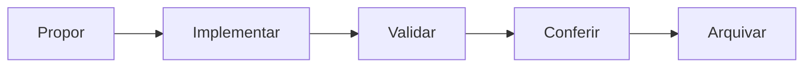

# Como o SAGER foi desenvolvido

O método usado, como o código está organizado, como ele é testado e o passo a passo para fazer uma mudança. A arquitetura e as decisões técnicas estão em [ARQUITETURA.md](ARQUITETURA.md); as regras de domínio e permissão, no [AGENTS.md](../AGENTS.md).

## 1. Método

O trabalho seguiu quatro etapas, descritas na monografia:

| Etapa | O que foi feito | Resultado |
| --- | --- | --- |
| Requisitos | Levantamento com a Assistência Estudantil do Campus Urutaí | 27 requisitos funcionais (RF001 a RF027), 18 regras de negócio (RN01 a RN18) e 24 casos de uso (UC01 a UC24) |
| Modelagem | UML e projeto do banco de dados | Diagramas de casos de uso, classes, sequência e entidade-relacionamento |
| Protótipo | Avaliação de usabilidade de um protótipo navegável com sete participantes (três servidores e quatro residentes) | Problemas observados que orientaram o redesenho das telas; SUS médio de 83,1 entre os quatro residentes, resultado indicativo |
| Implementação | Sistema construído e verificado por testes automatizados e numa homologação técnica | Interface Angular, API Spring Boot e banco PostgreSQL |

A monografia é a referência do sistema. Ela não fica no repositório; peça o PDF aos autores. Quando o código e o texto divergem, a divergência é corrigida ou registrada numa change do OpenSpec, com o motivo.

## 2. Desenvolvimento guiado por especificação

Até 31/10/2026, cada fase seguia um contrato em `docs/`. Desde então, o comportamento esperado de cada capacidade fica em [`openspec/specs`](../openspec/specs/), um arquivo por capacidade, com requisitos e cenários. As specs das regras centrais (change `document-core-baseline`) citam o RF, a RN ou o caso de uso da monografia de onde vêm; as demais registram decisões tomadas depois, explicadas na change que as criou.

Toda mudança de comportamento passa por este ciclo:

Uma change fica em `openspec/changes/<nome>/` e tem:

- `proposal.md`: por que, o que muda, impacto e o que fica de fora;
- `specs/<capacidade>/spec.md`: os requisitos novos ou alterados;
- `design.md`: cada decisão com a alternativa descartada e o que a instituição ainda precisa decidir;
- `tasks.md`: as tarefas, cada uma dizendo como é verificada.

O texto é em português, mas os títulos estruturais (`## Why`, `### Requirement:`, `#### Scenario:`) e as palavras SHALL, MUST, GIVEN, WHEN e THEN ficam em inglês; senão a validação falha. As regras de cada arquivo estão em `openspec/config.yaml`. Mudança só de documentação ou ferramenta declara `skip_specs: true` no `.openspec.yaml` da change e não tem spec. As changes arquivadas em `openspec/changes/archive/` são o histórico do projeto e não se editam.

O passo a passo está na [seção 6](#6-como-fazer-uma-mudança).

## 3. Organização do código

O código é dividido por área do negócio, não por tipo técnico. Quem procura a chamada noturna encontra tudo dela num lugar só.

**Interface** (`frontend/src/app`)

- `core/`: sessão, perfil ativo, mensagens de erro e utilitários de lista.
- `shared/`: componentes reutilizados, como cabeçalho de página, paginação e campo de senha.
- `features/<área>/`: telas, rotas, modelos, estilos e serviços de cada área (`management`, `operations`, `communications`, `cleaning`, `reports` e `portal`).
- Cada área tem um serviço `*-api.service.ts`, que fala com a API, e, quando há demonstração, um `*-demo` com dados fictícios em memória.

**API** (`backend/src/main/java/br/edu/ifgoiano/sager`)

- Um pacote por área (`management`, `operations`, `discipline`, `cleaning`, `reports` e outros).
- Dentro de cada área, o *controller* recebe a requisição, e o *service* aplica a validação, a regra, a permissão e a auditoria numa transação. O SQL é explícito (JdbcTemplate): nos cadastros, nas operações, na auditoria, nas contas e no WhatsApp, fica num *repository*; em limpeza, disciplina, comunicações, relatórios e cursos, fica no próprio *service*.
- O banco evolui só por migrações Flyway numeradas em `backend/src/main/resources/db/migration/`. Migração aplicada nunca é editada: a correção vem numa migração nova.

**Regras que valem para o código todo**

- A permissão é decidida no servidor, por operação e por registro. A interface só esconde o que não cabe ao perfil.
- Toda escrita sobre registro existente envia a versão lida. Se outra pessoa alterou antes, a gravação é recusada com conflito, e nada é sobrescrito.
- Toda alteração grava um evento de auditoria na mesma transação.
- Datas e prazos usam o relógio do servidor e o fuso `America/Sao_Paulo`.
- A demonstração nunca chama a API, e uma falha da API nunca é coberta por dados de exemplo.

## 4. Padrões de código

| Tema | Padrão |
| --- | --- |
| Formatação da interface | Prettier com 2 espaços, aspas simples e 100 colunas (`frontend/.prettierrc`). Formate os arquivos tocados com `npx prettier --write <arquivo>`. |
| Componentes | Standalone, com Signals para estado e Reactive Forms tipados para formulários. |
| Nomes de arquivo | kebab-case com sufixo do papel: `resident-form.component.ts`, `courses.page.ts`, `resident-api.service.ts`. |
| Testes | Ao lado do código, como `*.spec.ts`. Jornadas de navegador em `frontend/e2e/`; testes do backend em `backend/src/test/java/`. |
| Textos da tela | Português simples, com ações bem rotuladas. A direção visual está em [DESIGN.md](../DESIGN.md). |
| Commits | Pequenos e por propósito, no formato `tipo(área): descrição`, como `feat(frontend): ...`, `test(e2e): ...` e `docs: ...`. |

## 5. Testes

| Nível | Ferramenta | Onde | O que cobre |
| --- | --- | --- | --- |
| Unidade e componente | Vitest | `frontend/src/**/*.spec.ts` | Regras de tela, formulários, permissões de interface e navegação |
| Integração | JUnit 6 e Testcontainers | `backend/src/test/java/` | API, regras, permissões, CSRF, migrações, restrições do banco, conflitos de versão e alterações simultâneas, contra um PostgreSQL descartável |
| Jornada no navegador | Playwright e axe-core | `frontend/e2e/` | Fluxos completos por perfil e acessibilidade |

As jornadas de navegador simulam a API. Elas provam que a interface funciona, mas não que o sistema completo funciona com o PostgreSQL; isso é papel dos testes de integração. Não há meta numérica de cobertura: cada mudança acrescenta testes para as regras, permissões, formulários e navegação que alterou.

## 6. Como fazer uma mudança

**Pré-requisitos:** Docker, Bash (no Windows, o Git Bash), JDK 21, Node.js 24 e Python 3. Os comandos do OpenSpec rodam com `npx @fission-ai/openspec@2.0.0 <comando>`, a mesma versão do `./sager ci`.

1. Atualize a `main` e crie uma branch: `git switch -c feat/<assunto>`.
2. Proponha a change e valide: `npx @fission-ai/openspec@2.0.0 validate <nome> --strict`.
3. Implemente uma tarefa por vez, com o teste dela, e marque `- [x]` só depois que o teste passar.
4. Confira se o código bate com a proposta, as specs e o design.
5. Rode `./sager ci` na raiz. Ele executa a validação do OpenSpec, os testes do backend, os testes e o build da interface, as jornadas de navegador e os testes de infraestrutura, com um log por etapa em `.ci/`, e leva cerca de 30 minutos.
6. Arquive a change com `npx @fission-ai/openspec@2.0.0 archive <nome>`, que incorpora as specs alteradas em `openspec/specs`.
7. Faça commits pequenos e abra o pull request com o resumo do comportamento, a change e os requisitos afetados, o resumo do `./sager ci` rodado no commit final e, para mudanças visuais, capturas de antes e depois.
8. Depois de mesclar na `main`, faça o deploy pelo [guia de produção](../infra/production/README.md) ou pelo [Coolify](../infra/coolify/README.md).

A execução de 17/10/2026 registrada na monografia rodou no GitHub Actions. Depois, o workflow foi desativado, e a mesma verificação passou a rodar com `./sager ci` no computador de quem desenvolve.

## 7. Dados e segredos

- Use só dados sintéticos em desenvolvimento, testes e capturas de tela.
- Nunca faça commit de senha, token, dado de residente, build gerado nem dos originais da monografia.
- Os segredos do ambiente local ficam em `.env.local`, criado pelo `./sager` e ignorado pelo Git. Em produção, vêm de arquivos de segredo externos.
